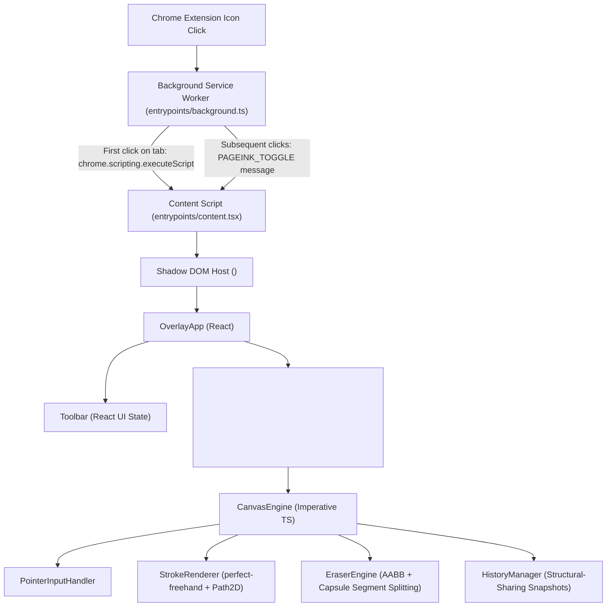

# PageInk Architecture

PageInk is designed around two core engineering principles:
1. **Strict Host-Page Isolation**: Never mutate webpage DOM content or leak styles into or out of the host document.
2. **Zero-React-Overhead Drawing**: Keep pointer tracking, stroke erasing, and canvas rendering completely imperative so React never re-renders on pointer movement.

---

## 1. High-Level System Overview

---

## 2. Component Responsibilities

### Background Service Worker (`entrypoints/background.ts`)
- Listens to `chrome.action.onClicked`.
- Ignores restricted browser pages (`chrome://`, `edge://`, `about:`, Chrome Web Store).
- Sends a `PAGEINK_TOGGLE` message to the active tab. If the content script has not yet been injected into that tab, it injects `content-scripts/content.js` on demand using `chrome.scripting.executeScript`.

### Content Script & Shadow DOM Host (`entrypoints/content.tsx`)
- Uses `registration: 'runtime'` so no content script runs until the user explicitly clicks the PageInk extension icon.
- Creates a Shadow DOM root (`<pageink-overlay>`) via WXT's `createShadowRootUi` with `cssInjectionMode: 'manual'`, injecting `src/styles/overlay.css?inline` directly into the Shadow Root.
- Mounts and unmounts `OverlayApp` cleanly when toggled or closed via `Escape` / Close button, ensuring all session state is discarded on close.

### React UI Layer (`src/components/OverlayApp.tsx` & `src/components/Toolbar.tsx`)
- **`OverlayApp`**:
  - Owns the top-level `ToolSettings` state (`activeTool`, `color`, `highlighterColor`, `penSize`, `highlighterSize`, `eraserSize`) and lightweight `HistoryStateSnapshot` (`canUndo`, `canRedo`, `hasStrokes`).
  - Instantiates `CanvasEngine` once on mount via `useRef`, passing a `handleHistoryChange` callback that only updates React state when `canUndo`, `canRedo`, or `hasStrokes` actually flips.
  - Listens for `Escape` (close) and `Ctrl+Z` / `Cmd+Z` / `Ctrl+Y` / `Ctrl+Shift+Z` (Undo/Redo) in the capture phase.
- **`Toolbar`**:
  - Renders the `344px` floating dark-charcoal toolbar with tool buttons (`Pen`, `Highlighter`, `Eraser`, `Undo`, `Redo`, `Clear All`, `Close`).
  - Implements self-contained pointer-captured dragging (`GripVertical` handle) clamped to the browser viewport bounds.
  - Stops pointer event propagation (`onPointerDown={(e) => e.stopPropagation()}`) so clicking or dragging the toolbar never starts a stroke on the underlying canvas.

---

## 3. Drawing Engine Architecture

### `CanvasEngine` (`src/engine/CanvasEngine.ts`)
- **Viewport-Sized Backing Store**: Sizes both the visible `<canvas>` and the offscreen `highlighterCanvas` to the visible viewport (`window.innerWidth * dpr` by `window.innerHeight * dpr`).
- **Two-Pass Layer Compositing**:
  1. **Highlighter Pass**: Renders all visible highlighter strokes at `1.0` alpha onto `highlighterCanvas`, then composites that buffer once onto the main canvas with `globalAlpha = 0.36` (`HIGHLIGHTER_OPACITY`). This prevents overlapping highlights from darkening each other and keeps highlights underneath pen ink.
  2. **Pen Pass**: Renders all visible pen strokes on top at `1.0` alpha.
  3. **Eraser Cursor Pass**: When `activeTool === 'eraser'`, renders a high-contrast dual-ring eraser circle at the current pointer position.
- **Document-Space Coordinates**: All stroke points are stored in document coordinates (`clientX + window.scrollX`, `clientY + window.scrollY`).
- **On-Demand `requestAnimationFrame`**: `scheduleRender()` queues at most one animation frame when state is dirty. Zero idle loops run.

### `PointerInputHandler` (`src/engine/PointerInputHandler.ts`)
- **Stylus Pressure & Normalization**: Detects hardware pressure across `pointerType === 'pen'` and mouse-emulated tablet drivers (`detectHardwarePressure`), applies a `0.8` gamma curve with exponential moving average (EMA) smoothing (`normalizeAndSmoothPressure`), and clamps pressure to `[0.12, 1.0]` to prevent zero-width strokes.
- **Multi-Touch & Palm Rejection**: Cancels accidental touch strokes when multi-touch gestures occur or when a stylus (`pointerType === 'pen'`) touches down over an active touch contact.
- **Pointer Capture & Coalesced Events**: Uses `setPointerCapture` and `getCoalescedEvents()` for high-report-rate mice and styluses.

### `StrokeRenderer` (`src/engine/StrokeRenderer.ts`)
- **Tool-Specific `perfect-freehand` Profiles**:
  - Hardware-pressure Pen (`thinning: 0.62`, sine easing, `simulatePressure: false`).
  - Mouse/touchpad fallback Pen (`thinning: 0.18`, `simulatePressure: true`).
  - Highlighter (`thinning: 0`, `simulatePressure: false` for uniform marker width).
- **`Path2D` Caching & Viewport Culling**: Caches both the computed `Path2D` and expanded `BoundingBox` on completed strokes and skips rendering offscreen strokes via `isBoundingBoxVisible()`.

---

## 4. Partial Segment Eraser & History Architecture

### `EraserEngine` (`src/engine/EraserEngine.ts`)
Rather than painting over the canvas with a background color (which breaks on transparent overlays) or deleting an entire stroke as soon as its bounding box is touched, PageInk implements a true geometric segment-splitting eraser:
1. **Stage 1 — Fast AABB Rejection (`doesEraserSweepIntersectBbox`)**: For each swept pointer movement segment `(x0, y0) -> (x1, y1)` with radius `eraserRadius`, strokes whose `BoundingBox` does not intersect the swept capsule's AABB are skipped in `O(1)` time, keeping their exact object reference and cached `Path2D`.
2. **Stage 2 — Segment Densification (`densifyStrokePoints`)**: Candidate strokes have any point-to-point gap longer than `5px` linearly subdivided (interpolating `x`, `y`, and `pressure`). This ensures that even a fast, two-point straight line can be cleanly erased right through its middle.
3. **Stage 3 — Capsule Hit Testing & Partitioning (`eraseStrokesAlongSegment`)**: Every point on the densified stroke is tested against the swept line segment `(x0, y0) -> (x1, y1)` using `distToSegmentSquared` with threshold `eraserRadius + stroke.size * 0.45`. Points inside the capsule are removed, and surviving contiguous point runs are emitted as new `Stroke` objects with freshly computed `BoundingBox` and `Path2D` caches—preserving original color, width, tool type, relative z-order, and per-point stylus pressure.

### `HistoryManager` (`src/engine/HistoryManager.ts`)
- **Structural-Sharing Immutable Snapshots**: Once a `Stroke` is committed (or emitted as a split fragment by `EraserEngine`), it is treated as immutable. Each entry in `undoStack` and `redoStack` is a shallow `readonly Stroke[]` array copy (`[...strokes]`).
- **Zero Memory Duplication**: Unchanged strokes share the exact same `Stroke` object reference, `points` array, and `cachedPath` across all history snapshots.
- **Grouped Continuous Erasing**: When an eraser drag begins (`pointerdown`), `CanvasEngine` snapshots `preEraseStrokesSnapshot = [...this.strokes]`. As the user drags across the canvas (`pointermove`), strokes are split interactively in real time without pushing intermediate states to `HistoryManager`. On `pointerup`, if at least one stroke was modified (`didEraseDuringGesture === true`), `preEraseStrokesSnapshot` is pushed as a single logical Undo entry. If the gesture is cancelled (`pointercancel`), `this.strokes` rolls back to `preEraseStrokesSnapshot`.
- **Reversible Clear All**: `clearAll()` records the current stroke array via `history.recordBeforeMutation(this.strokes)` and replaces `this.strokes` with `[]`, allowing a single Undo to restore every Pen and Highlighter stroke in exact order and Redo to clear them again.
