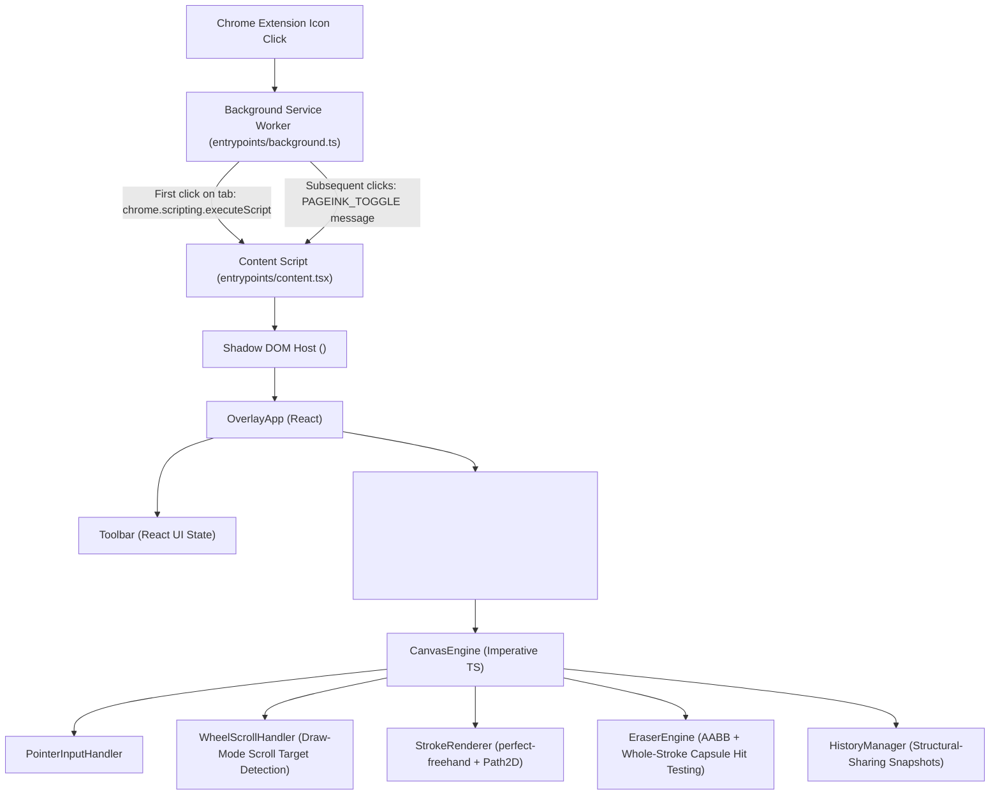

# PageInk Architecture

PageInk is designed around two core engineering principles:
1. **Strict Host-Page Isolation**: Never mutate webpage DOM content or leak styles into or out of the host document.
2. **Zero-React-Overhead Drawing**: Keep pointer tracking, stroke erasing, and canvas rendering completely imperative so React never re-renders on pointer movement.

---

## 1. High-Level System Overview

---

## 2. Component Responsibilities

### Background Service Worker (`entrypoints/background.ts`)
- Listens to `chrome.action.onClicked`.
- Ignores restricted browser pages (`chrome://`, `edge://`, `about:`, Chrome Web Store).
- Sends a `PAGEINK_TOGGLE` message to the active tab. If the content script has not yet been injected into that tab, it injects `content-scripts/content.js` on demand using `chrome.scripting.executeScript`.

### Content Script & Shadow DOM Host (`entrypoints/content.tsx`)
- Uses `registration: 'runtime'` so no content script runs until the user explicitly clicks the PageInk extension icon.
- Creates a Shadow DOM root (`<pageink-overlay>`) via WXT's `createShadowRootUi` with `cssInjectionMode: 'manual'`, injecting `src/styles/overlay.css?inline` directly into the Shadow Root.
- Mounts and unmounts `OverlayApp` cleanly when toggled or closed via `Escape` / Close button, ensuring all session state is discarded on close.

### React UI Layer (`src/components/OverlayApp.tsx` & `src/components/Toolbar.tsx`)
- **`OverlayApp`**:
  - Owns the top-level `ToolSettings` state (`activeTool`, `color`, `highlighterColor`, `penSize`, `highlighterSize`, `eraserSize`) and lightweight `HistoryStateSnapshot` (`canUndo`, `canRedo`, `hasStrokes`).
  - Instantiates `CanvasEngine` once on mount via `useRef`, passing a `handleHistoryChange` callback that only updates React state when `canUndo`, `canRedo`, or `hasStrokes` actually flips.
  - Updates tool settings (`handleSelectTool`, `handleSelectColor`, `handleChangeSize`) in memory only and forwards them to `CanvasEngine` via `engine.updateSettings(settings)` without triggering redundant canvas redraws when only color or thickness changes.
  - Manages **Hold-Space Passthrough (Browse Mode)** (`isPassthrough`), checking `isEditableEventTarget(e)` via `e.composedPath()` so `Space` and `Ctrl+Z` are never intercepted when typing in `<input>`, `<textarea>`, or `contentEditable` fields.
  - Listens for `Escape` (close) and `Ctrl+Z` / `Cmd+Z` / `Ctrl+Y` / `Ctrl+Shift+Z` (Undo/Redo) in the capture phase.
- **`Toolbar`**:
  - Renders the `348px` floating dark-charcoal toolbar with primary tool buttons (`Pen`, `Highlighter`, `Eraser`, `Undo`, `Redo`, `Clear All`, `Close`).
  - Renders a contextual customization sub-row (`pi-toolbar-subrow`) when `Pen` or `Highlighter` is selected, providing:
    - **8 Pen Colors** (Black, White, Red, Orange, Yellow, Green, Blue, Purple) and **4 Highlighter Colors** (Yellow, Green, Pink, Blue).
    - **Independent Thickness Controls** (`1–12px` for Pen, `8–32px` for Highlighter) with a live visual dot preview (`pi-thickness-dot`) and range slider.
  - Implements self-contained pointer-captured dragging (`GripVertical` handle) clamped to the browser viewport bounds.
  - Stops pointer event propagation (`onPointerDown={(e) => e.stopPropagation()}`) so clicking swatches, adjusting the thickness slider, or dragging the toolbar never starts a stroke on the underlying canvas.

---

## 3. Drawing Engine Architecture

### `CanvasEngine` (`src/engine/CanvasEngine.ts`)
- **Viewport-Sized Backing Store**: Sizes both the visible `<canvas>` and the offscreen `highlighterCanvas` to the visible viewport (`window.innerWidth * dpr` by `window.innerHeight * dpr`).
- **Multi-Pass Layer Compositing**:
  1. **Highlighter Pass (Grouped by Color)**: Renders visible highlighter strokes of each active color at `1.0` alpha onto `highlighterCanvas`, then composites each color pass once onto the main canvas with `globalAlpha = 0.36` (`HIGHLIGHTER_OPACITY`). This prevents overlapping highlights of the same color from darkening each other while allowing distinct highlighter colors (Yellow, Green, Pink, Blue) to remain visually distinct underneath pen ink.
  2. **Pen Pass**: Renders all visible pen strokes on top at `1.0` alpha.
  3. **Eraser Cursor Pass**: When `activeTool === 'eraser'`, renders a high-contrast dual-ring eraser circle at the current pointer position.
- **Document-Space Coordinates**: All stroke points are stored in document coordinates (`clientX + window.scrollX`, `clientY + window.scrollY`).
- **On-Demand `requestAnimationFrame`**: `scheduleRender()` queues at most one animation frame when state is dirty. Zero idle loops run.

### `PointerInputHandler` (`src/engine/PointerInputHandler.ts`)
- **Stylus Pressure & Normalization**: Detects hardware pressure across `pointerType === 'pen'` and mouse-emulated tablet drivers (`detectHardwarePressure`), applies a `0.8` gamma curve with exponential moving average (EMA) smoothing (`normalizeAndSmoothPressure`), and clamps pressure to `[0.12, 1.0]` to prevent zero-width strokes.
- **Multi-Touch & Palm Rejection**: Cancels accidental touch strokes when multi-touch gestures occur or when a stylus (`pointerType === 'pen'`) touches down over an active touch contact.
- **Pointer Capture & Coalesced Events**: Uses `setPointerCapture` and `getCoalescedEvents()` for high-report-rate mice and styluses.

### `StrokeRenderer` (`src/engine/StrokeRenderer.ts`)
- **Tool-Specific `perfect-freehand` Profiles**:
  - Hardware-pressure Pen (`thinning: 0.62`, sine easing, `simulatePressure: false`).
  - Mouse/touchpad fallback Pen (`thinning: 0.18`, `simulatePressure: true`).
  - Highlighter (`thinning: 0`, `simulatePressure: false` for uniform marker width).
- **`Path2D` Caching & Viewport Culling**: Caches both the computed `Path2D` and expanded `BoundingBox` on completed strokes and skips rendering offscreen strokes via `isBoundingBoxVisible()`.

---

## 4. Whole-Stroke Eraser, Wheel Scrolling & History Architecture

### `WheelScrollHandler` (`src/engine/WheelScrollHandler.ts`)
Because the viewport-sized `<canvas>` sits above the webpage with `pointer-events: auto` while in Draw mode, native wheel events target the canvas rather than underlying scrollable `
` containers (such as ChatGPT's conversation scroller). `WheelScrollHandler` solves this cleanly without dispatching untrusted synthetic events:
1. **Browser Zoom & Browse Mode Bypass**: If `e.ctrlKey` or `e.metaKey` is held (browser zoom / trackpad pinch) or if Hold-Space Browse Mode (`isPassthrough`) is active, the handler returns immediately so the browser's native behavior runs unmodified.
2. **Underlying Element Hit-Testing**: Temporarily sets `canvas.style.pointerEvents = 'none'`, calls `document.elementFromPoint(e.clientX, e.clientY)` to identify the exact webpage element beneath the cursor, and immediately restores `canvas.style.pointerEvents`.
3. **Scrollable Ancestor Resolution (`findScrollableTarget`)**: Walks up the DOM ancestor chain (including across Shadow DOM boundaries) checking `getComputedStyle(el).overflowY` / `overflowX` and remaining scroll range (`scrollTop < scrollHeight - clientHeight`, etc.) in the wheel's `(dx, dy)` direction. Falls back to `document.scrollingElement` when no inner container can scroll.
4. **Direct Scroll Execution**: Calls `scrollTarget.scrollBy({ left: dx, top: dy, behavior: 'auto' })` and records primary page scroll containers on `CanvasEngine` so document-coordinate annotations stay locked to the scrolled content.

### `EraserEngine` (`src/engine/EraserEngine.ts`)
PageInk implements a fast, whole-stroke geometric eraser:
1. **Stage 1 — Fast AABB Rejection (`doesEraserSweepIntersectBbox`)**: For each swept pointer movement segment `(x0, y0) -> (x1, y1)` with radius `eraserRadius`, strokes whose `BoundingBox` does not intersect the swept capsule's AABB are skipped in `O(1)` time.
2. **Stage 2 — Segment-to-Segment Capsule Hit Testing (`doesEraserHitStroke` & `segmentToSegmentDistSquared`)**: For candidate strokes, each polyline segment is tested against the swept eraser segment `(x0, y0) -> (x1, y1)` with hit threshold `eraserRadius + stroke.size * 0.5`. Touching the beginning, middle, or end of any Pen or Highlighter stroke removes that entire `Stroke` object while leaving separate overlapping strokes untouched.

### `HistoryManager` (`src/engine/HistoryManager.ts`)
- **Structural-Sharing Immutable Snapshots**: Each entry in `undoStack` and `redoStack` is a shallow `readonly Stroke[]` array copy (`[...strokes]`).
- **Zero Memory Duplication**: Unchanged and erased strokes retain their exact `Stroke` object reference, `points` array, and `cachedPath` across all history snapshots—restoring a deleted stroke via Undo requires zero geometry recalculation.
- **Grouped Continuous Erasing**: When an eraser drag begins (`pointerdown`), `CanvasEngine` snapshots `preEraseStrokesSnapshot = [...this.strokes]`. As the user drags across the canvas (`pointermove`), touched strokes are removed interactively in real time. On `pointerup`, if at least one stroke was removed (`didEraseDuringGesture === true`), `preEraseStrokesSnapshot` is pushed as a single logical Undo entry.
- **Reversible Clear All**: `clearAll()` records the current stroke array via `history.recordBeforeMutation(this.strokes)` and replaces `this.strokes` with `[]`, allowing a single Undo to restore every Pen and Highlighter stroke in exact order and Redo to clear them again.
