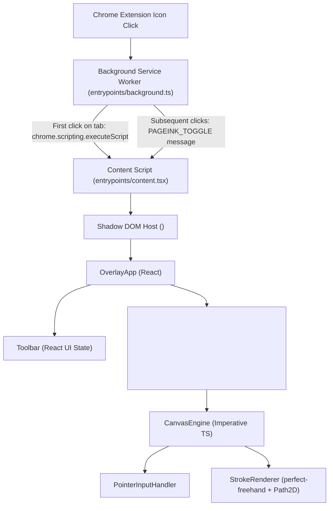

# PageInk Architecture

PageInk is designed around two core engineering principles:
1. **Strict Host-Page Isolation**: Never mutate webpage DOM content or leak styles into or out of the host document.
2. **Zero-React-Overhead Drawing**: Keep pointer tracking and canvas rendering completely imperative so React never re-renders on pointer movement.

---

## 1. High-Level System Overview

---

## 2. Component Responsibilities

### Background Service Worker (`entrypoints/background.ts`)
- Listens to `chrome.action.onClicked`.
- Ignores restricted browser pages (`chrome://`, `edge://`, `about:`, Chrome Web Store).
- Sends a `PAGEINK_TOGGLE` message to the active tab. If the content script has not yet been injected into that tab, it injects `content-scripts/content.js` on demand using `chrome.scripting.executeScript`.

### Content Script & Shadow DOM Host (`entrypoints/content.tsx`)
- Uses `registration: 'runtime'` so no content script runs until the user explicitly clicks the PageInk extension icon.
- Creates a Shadow DOM root (`<pageink-overlay>`) via WXT's `createShadowRootUi` with `cssInjectionMode: 'manual'`, injecting `src/styles/overlay.css?inline` directly into the Shadow Root.
- Mounts and unmounts `OverlayApp` cleanly when toggled or closed via `Escape` / Close button, ensuring all session state is discarded on close.

### React UI Layer (`src/components/OverlayApp.tsx` & `src/components/Toolbar.tsx`)
- **`OverlayApp`**:
  - Owns the top-level `ToolSettings` state (`activeTool`, `color`, `penSize`, `highlighterSize`, `eraserSize`).
  - Instantiates `CanvasEngine` once on mount via `useRef` and forwards settings updates via `engine.updateSettings(settings)`.
  - Listens for `Escape` keydown in the capture phase to close the overlay immediately.
- **`Toolbar`**:
  - Renders the `344px` floating dark-charcoal toolbar with tool buttons (`Pen`, `Highlighter`, `Eraser`, `Undo`, `Redo`, `Clear All`, `Close`).
  - Implements self-contained pointer-captured dragging (`GripVertical` handle) clamped to the browser viewport bounds.
  - Stops pointer event propagation (`onPointerDown={(e) => e.stopPropagation()}`) so clicking or dragging the toolbar never starts a stroke on the underlying canvas.

---

## 3. Drawing Engine Architecture

### `CanvasEngine` (`src/engine/CanvasEngine.ts`)
- **Viewport-Sized Backing Store**: Instead of creating a massive full-document canvas that exhausts GPU memory on long pages, `CanvasEngine` sizes the `<canvas>` to the visible viewport (`window.innerWidth * dpr` by `window.innerHeight * dpr`).
- **Document-Space Coordinates**: All stroke points are stored in document coordinates (`clientX + window.scrollX`, `clientY + window.scrollY`). During `renderFrame()`, the 2D context is scaled by `dpr` and translated by `(-window.scrollX, -window.scrollY)`.
- **Lossless Resize**: On `window.resize`, `updateCanvasDimensions()` updates the canvas backing store dimensions and immediately triggers a synchronous `renderFrame()` so existing strokes remain crisp and never flash blank.
- **On-Demand `requestAnimationFrame`**: `scheduleRender()` queues at most one animation frame when a stroke starts, moves, ends, or when the viewport scrolls/resizes. When idle, zero animation loops run.

### `PointerInputHandler` (`src/engine/PointerInputHandler.ts`)
- **Pointer Capture**: Calls `canvas.setPointerCapture(e.pointerId)` on primary `pointerdown` (`e.button === 0`) and tracks `activePointerId` so secondary touches or stray pointers cannot corrupt an in-progress stroke.
- **Coalesced Events**: Reads `e.getCoalescedEvents()` on `pointermove` to capture all high-frequency intermediate samples from gaming mice and pen tablets between animation frames.
- **Sub-Pixel Deduplication & Clamping**: Filters out redundant points closer than `0.5px` (`dx*dx + dy*dy < 0.25`) and clamps coordinates to `[0, innerWidth]` / `[0, innerHeight]`.
- **Selection & Cancellation Safety**: Clears accidental host-page text selections (`window.getSelection()?.removeAllRanges()`) and gracefully handles `pointercancel`, `lostpointercapture`, and `window.blur`.

### `StrokeRenderer` (`src/engine/StrokeRenderer.ts`)
- **Outline Generation**: Uses `perfect-freehand`'s `getStroke()` to compute variable-width polygon outlines from input points and converts them into smooth quadratic Bézier SVG path strings (`getSvgPathFromStroke`).
- **`Path2D` Caching**: While a stroke is actively being drawn (`isComplete = false`), its `Path2D` is computed per frame. Once completed on `pointerup`, the resulting `Path2D` and expanded `BoundingBox` are cached on the `Stroke` object so subsequent redraws (e.g., during scrolling or drawing new strokes) execute a fast native `ctx.fill(stroke.cachedPath)` without recalculating geometry.
- **Viewport Culling**: `isBoundingBoxVisible()` skips `ctx.fill()` for any stroke whose document bounding box lies outside the current viewport rectangle.

